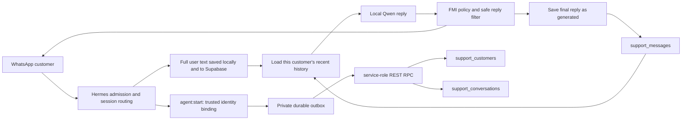

# Architecture

## Sales workflow routing

Version 1.9.0 consumes admitted direct WhatsApp text through a bounded
three-agent desk: listener JSON, sales reply, reviewer JSON, one optional
rewrite. The gender tool is still a separate completion. They do not enter
the Hermes 150-iteration thinking agent. `/switch` picks local Ollama or the
OpenAI API; the key stays in env. The older Qwen JSON workflow stays available
only when a test/decider is passed. The phrase matcher in `sales.py:advance`
is a legacy test reference and does not classify gender.

Hermes already has a learning journey (`agent.learning_graph`) over skills
and MEMORY.md. That customer-memory switch stays off. FMI appends an
operator retrospective at `state/fmi-support/learning.jsonl` with no
customer name. A subagent may propose a tool; proposals are not installed.

Replies are one short completion. A 40-second admission timeout sends the
holding sentence instead of hanging.
A durable per-chat handover generation invalidates in-flight replies even if the
operator pauses and resumes before generation completes. Model reasoning is never
stored in customer history or shown to customers. See [WORKFLOWS.md](WORKFLOWS.md).

## Boundaries

The website already uses `SUPABASE_URL` and `SUPABASE_SERVICE_ROLE_KEY` with
PostgREST (`server/core.mjs`). This module reuses those project credentials on
the **support host**, without adding a public HTTP endpoint or browser secret.
The existing `invitations`, `responses`, Auth users, and analytics remain separate.

The Hermes `agent:start` gateway event runs after admission/session preparation.
The hook is deliberately used instead of `pre_gateway_dispatch`, which fires
before authorization. Only `platform=whatsapp, chat_type=dm`, a valid adapter
user ID, and a session ID are accepted. The hook currently cannot receive sender
display names, transport message IDs, or structured profile fields. Do not scrape
those from free-form messages. First/last times reflect support processing time,
not a claimed device timestamp. Internal continuation turns can refresh the
existing session's last-seen time; this is not a message-count analytics ledger.

## Persistence and reliability

`channel + channel_identity` is the customer uniqueness boundary. Valid phone
formats normalize to `phone:+<digits>`. `@lid` stays `lid:<digits>` and never
becomes an E.164 number. Conversation uniqueness is `customer_id + hermes_session_id`.
The invoker-rights RPC upserts both in one transaction. `least(first_seen)` and
`greatest(last_seen)` prevent delayed delivery from moving history backwards.

Each profile has its own `state/fmi-support/outbox.sqlite3`. Enqueue happens
before returning from the event hook, with filesystem operations off the event
loop. A background task drains at most 20 entries per pass; each request times
out after five seconds. Failures remain durable with bounded exponential retry.
Items for the same customer/session coalesce. Revision-checked deletion prevents
a successful request from deleting a newer pending event. A lost success response
can cause a duplicate request; database constraints make that safe. This is
at-least-once metadata delivery, not exactly-once message processing. The same
private SQLite file also contains the text journal and scoped history cache;
see [HISTORY.md](HISTORY.md) for full-message persistence and retrieval.

A full/unwritable local disk cannot be made durable; it logs an operator error.
Queue failures do not tell the customer that their details were saved. The queue
must be monitored by an operator; automatic alert routing is future work.

## Access and isolation

- Both tables have RLS and explicit revocation from public/anonymous/signed-in
  browser roles. Only the service role can read/write or execute the RPC.
- The service key is stored in a mode-0600 profile file, outside the repo and
  model context. HTTPS is required except for a loopback test Supabase URL.
  HTTP redirects are refused so credentials cannot follow a redirect.
- WhatsApp model tools are initially empty; intake is trusted host code. Shared
  Hermes memory/user-profile injection is disabled to avoid cross-customer recall.
- Existing admission settings are preserved. Do not widen access as a side
  effect of installation; a dedicated public support number is an operator choice.
- No customer record is automatically linked to `auth.users` or invitations.
  Future authenticated tools need a separate ownership proof.
- The reply filter is defense in depth, not a guarantee against every future
  model phrase or Hermes system message. Built-in diagnostics are suppressed,
  known static errors use a locale overlay, and regression tests cover known paths.

Access model follows [Supabase Data API security](https://supabase.com/docs/guides/api/securing-your-api).
The 2026-10-12 TLS notice was checked; the current Python/OpenSSL client supports
modern TLS. Keep the support host runtime patched.

## Future extension points

1. Persona: approved support identity, languages, product terms, tone evaluations.
2. Orchestration: typed intent routing, authenticated business tools, human
   assignment, explicit state transitions, idempotent actions, delivery receipts.
3. RAG: approved/versioned source documents, ingestion, retrieval filters,
   provenance/citations, freshness, and evaluations. No customer transcripts as
   general shared knowledge. Add pgvector only when retrieval is implemented.

Keep policy, transport, storage, retrieval, and business tools separate. A small
Python integration around Hermes is sufficient now; no separate chatbot backend,
message broker, vector database, or frontend framework is required for intake.
